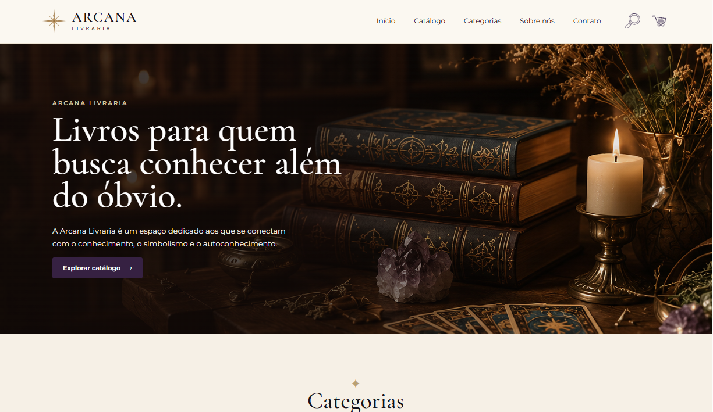
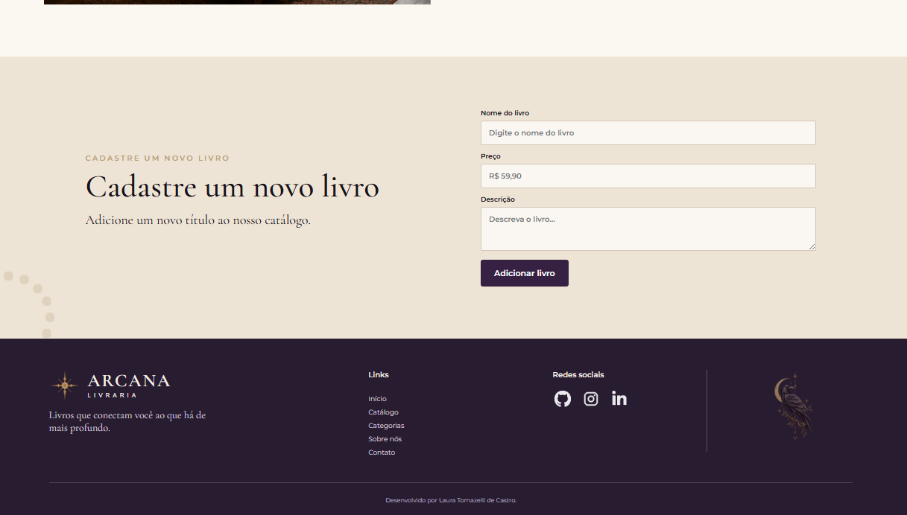

# Arcana Livraria — Exercício Styled Components

Projeto desenvolvido com React e Vite, adaptado para praticar CSS-in-JS com **Styled Components**.

A Arcana Livraria é uma livraria fictícia voltada para livros relacionados a autoconhecimento, espiritualidade, simbolismo, astrologia e magia natural.

## Funcionalidades

- Página inicial com hero e navegação
- Categorias e catálogo de livros
- Cartões de produtos reutilizáveis
- Botão de adicionar ao carrinho com estilo dinâmico usando a prop `adicionado`
- Botão verde (`#198754`) quando o produto já foi adicionado ao carrinho e cinza (`#6c757d`) quando ainda não foi adicionado
- Visualização de detalhes dos livros
- Cadastro e exclusão de livros
- Contador de itens no carrinho
- Mensagens de confirmação
- Alternância automática entre imagens da livraria
- Layout responsivo

## Tecnologias

- React
- JavaScript
- Vite
- Styled Components
- CSS
- Git e GitHub

## Styled Components

O componente `src/components/ProductCard.jsx` utiliza Styled Components para definir a estrutura e os estilos do cartão de produto por meio de template literals.

A prop pública `adicionado` determina o estado visual do botão. Para não repassar essa prop de estilização ao elemento HTML, o componente usa a prop transitória `$adicionado` internamente no Styled Components.

## Como executar localmente

1. Instale o [Node.js](https://nodejs.org/) se ainda não estiver instalado.
2. Abra a pasta do projeto no terminal.
3. Instale as dependências:

   ```bash
   npm install
   ```

4. Inicie o servidor de desenvolvimento:

   ```bash
   npm run dev
   ```

5. Para verificar a compilação de produção:

   ```bash
   npm run build
   ```

## Prints

Os prints existentes do projeto foram mantidos:

### Menu e Hero



### Catálogo


### Formulário e Footer


