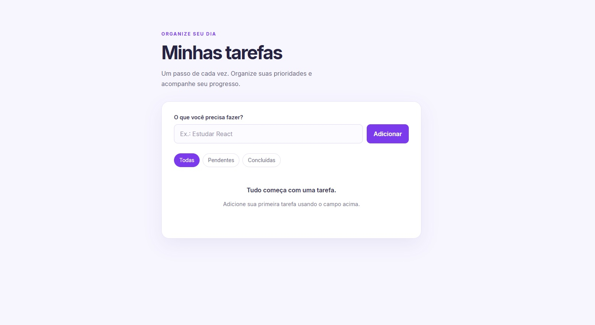
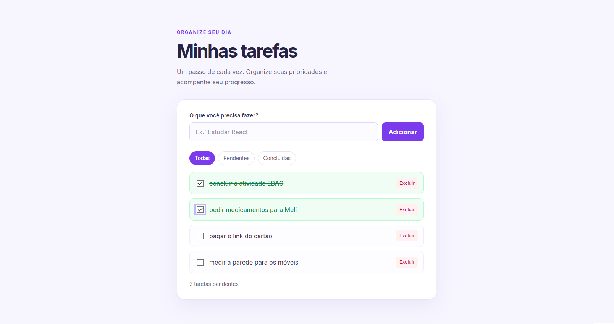
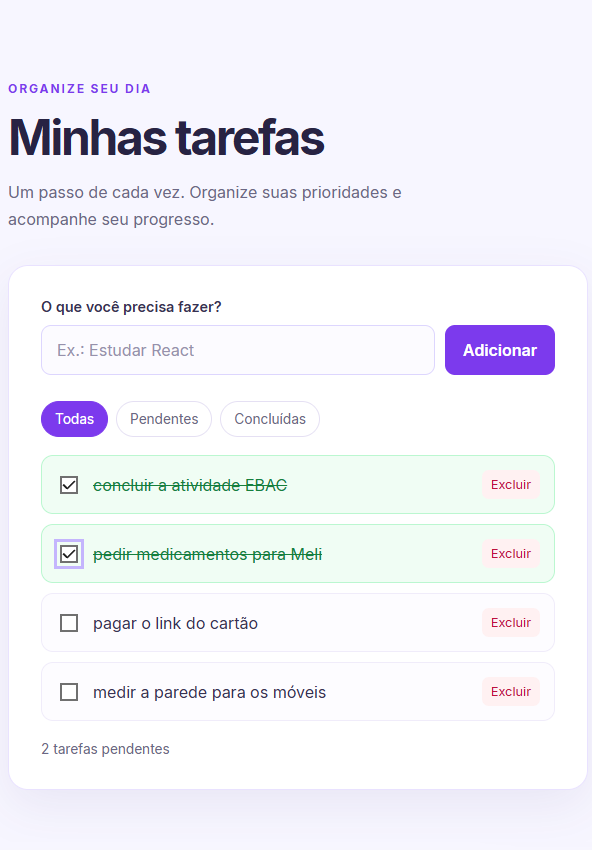

# 📝 Todo List — React Avançado

Aplicação de lista de tarefas desenvolvida com React e Vite como parte dos estudos de desenvolvimento Front-End na EBAC.

O projeto permite organizar tarefas do dia a dia, acompanhar seu andamento e manter os dados salvos no navegador. O foco foi praticar gerenciamento de estado, Context API, hooks e otimização de renderização em React.

## Demonstração

### Tela principal

### Filtros e tarefas concluídas

### Layout responsivo

## Funcionalidades

- Adicionar novas tarefas.
- Impedir o cadastro de tarefas vazias.
- Marcar tarefas como concluídas ou pendentes.
- Excluir tarefas.
- Filtrar tarefas por todas, pendentes e concluídas.
- Visualizar a quantidade de tarefas pendentes.
- Salvar tarefas no `localStorage`, mantendo os dados após atualizar

## Tecnologias utilizadas

- React
- JavaScript
- Vite
- HTML5
- CSS3
- localStorage
- Git e GitHub

## Conceitos praticados

- Componentização: divisão da aplicação em componentes reutilizáveis.
- useState: gerenciamento de estados locais.
- useEffect: sincronização dos dados com o localStorage.
- Context API e useContext: compartilhamento de estado e funções entre componentes.
- Hook personalizado: criação do hook useLocalStorage para persistência dos dados.
- useMemo: memorização da lista filtrada.
- React.memo: otimização de renderização do componente de tarefa.
- Renderização de listas: utilização de map() e chaves únicas.
- Renderização condicional: exibição de mensagens conforme o estado da lista.
- Responsividade: adaptação da interface a diferentes larguras de tela.
- Acessibilidade: uso de rótulos e atributos ARIA nos controles.