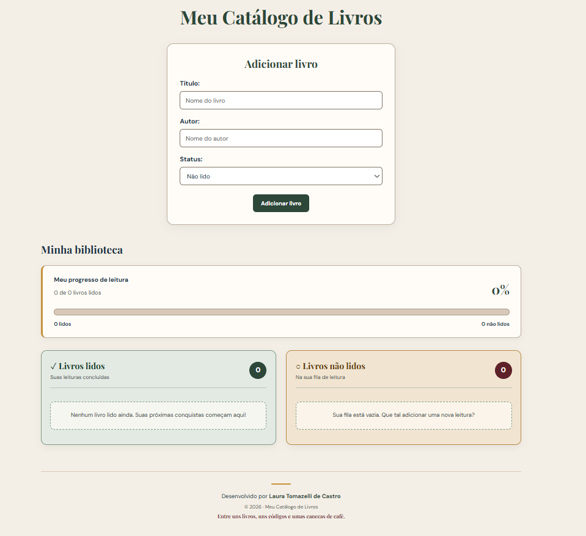
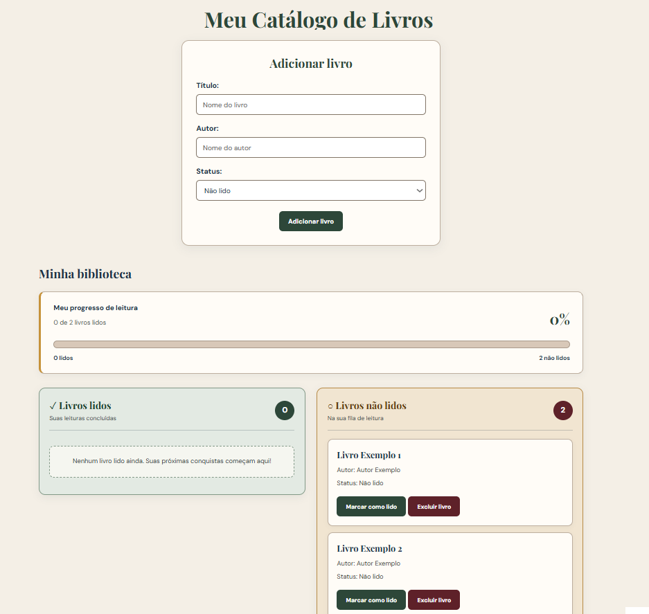
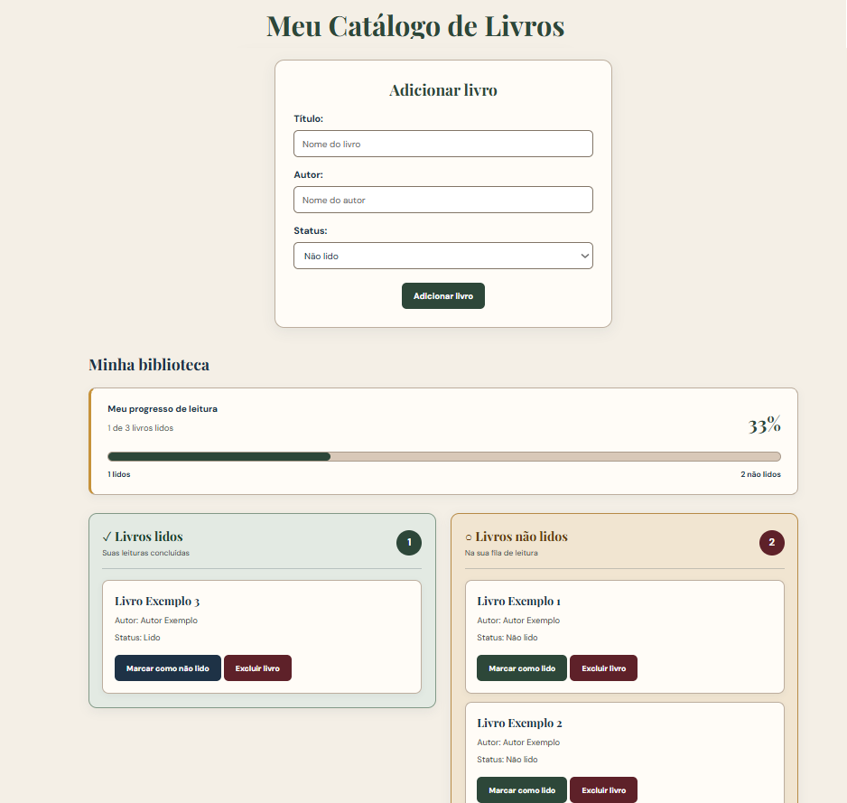
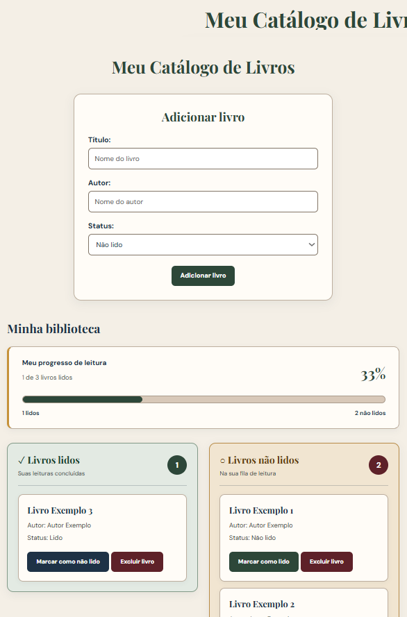

# 📚 Meu Catálogo de Livros

Aplicação desenvolvida em React e TypeScript para cadastrar, organizar e acompanhar livros, utilizando a API REST do CrudCrud.

## ✨ Funcionalidades

- Cadastrar livros com título, autor e status.
- Listar livros cadastrados.
- Excluir livros.
- Alterar o status entre "Lido" e "Não lido".
- Visualizar livros separados por status.
- Acompanhar a quantidade de livros lidos e o progresso de leitura.
- Interface responsiva.

## Screenshots

### Tela inicial

### Catálogo com livros não lidos

### Catálogo com livros lidos e não lidos

### Versão em tela pequena

## Tecnologias utilizadas

- React
- TypeScript
- Vite
- Axios
- CSS
- CrudCrud (API REST)

## 👩‍💻 Desenvolvido por

**Laura Tomazelli de Castro**